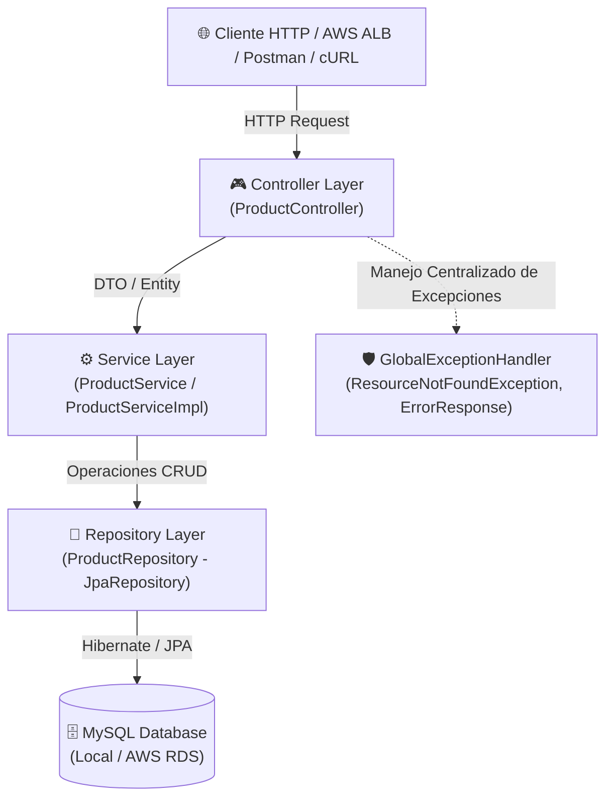
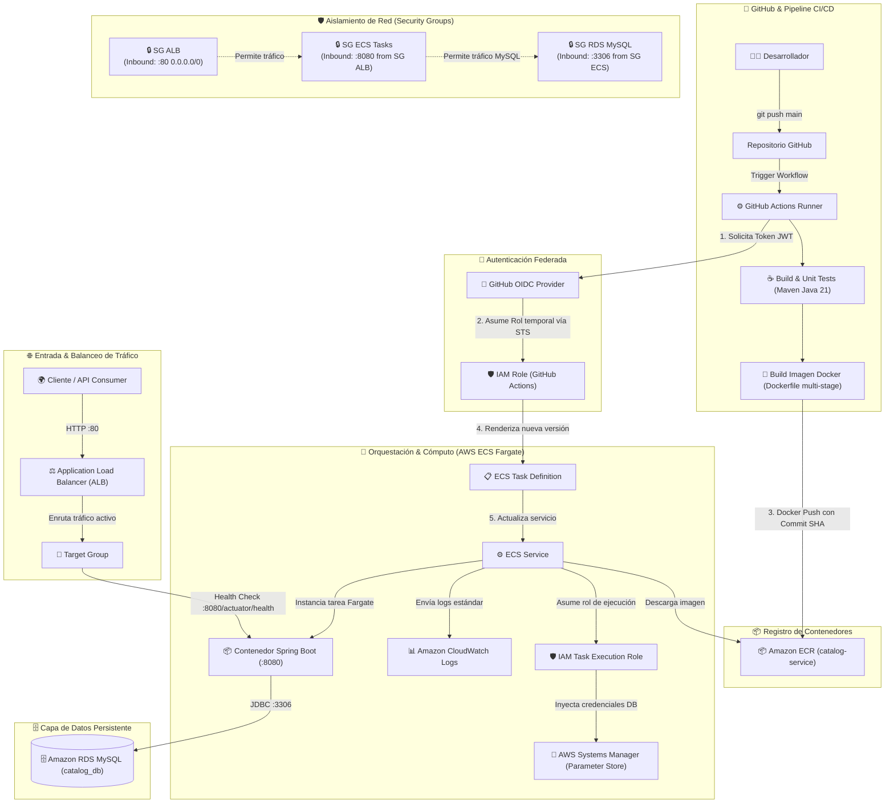

# 📦 Catalog Service API - Base Lab AWS & GitHub Actions

Microservicio REST desarrollado en **Java** con **Spring Boot** para la gestión de un catálogo de productos. Este repositorio sirve como proyecto base para laboratorios de integración continua y despliegue continuo (**CI/CD**) mediante **GitHub Actions** hacia infraestructura en **Amazon Web Services (AWS)**.

---

## 🚀 1. Tecnologías Utilizadas

| Categoría | Tecnología / Herramienta | Versión / Detalle |
| :--- | :--- | :--- |
| **Lenguaje** | [Java](https://www.oracle.com/java/) | 21 (LTS) |
| **Framework Base** | [Spring Boot](https://spring.io/projects/spring-boot) | 4.1.2 |
| **Capa Web** | Spring MVC (`spring-boot-starter-webmvc`) | Creación de endpoints y controladores REST |
| **Persistencia / ORM** | Spring Data JPA / Hibernate | Mapeo objeto-relacional y consultas CRUD |
| **Base de Datos** | [MySQL](https://www.mysql.com/) | 8.x (Driver: `mysql-connector-j`) |
| **Pool de Conexiones** | HikariCP | Configurado con optimizaciones en perfil `prod` |
| **Manejo de Errores** | `@RestControllerAdvice` | Respuestas estandarizadas de excepciones |
| **Monitoreo / Salud** | Spring Boot Actuator | Probes de Liveness/Readiness (`/actuator/health`) para balanceadores AWS |
| **Productividad** | Lombok | Reducción de código repetitivo (Boilerplate) |
| **Gestor de Construcción**| Apache Maven | Incluye Maven Wrapper (`mvnw` / `mvnw.cmd`) |
| **Destino de Despliegue** | AWS (EC2 / ECS / App Runner / Elastic Beanstalk) | Integración con RDS MySQL y GitHub Actions |

---

## 🏛️ 2. Arquitectura de la Aplicación

La aplicación está diseñada bajo el patrón de **Arquitectura en Capas (Layered Architecture)**, asegurando la separación de responsabilidades y modularidad.

### 2.1 Diagrama de Capas del Software



### 2.2 Descripción de Capas

1. **Capa de Controladores (`com.icodeap.catalog.controller`)**:
   - `ProductController`: Expone los endpoints REST bajo la ruta `/api/v1/products`, mapea las peticiones HTTP, delega la lógica al servicio correspondiente y devuelve las respuestas con sus códigos HTTP estándar.
2. **Capa de Negocio / Servicios (`com.icodeap.catalog.service`)**:
   - `ProductService` & `ProductServiceImpl`: Gestionan las reglas de negocio, validaciones y la orquestación de operaciones de catálogo.
3. **Capa de Persistencia (`com.icodeap.catalog.repository`)**:
   - `ProductRepository`: Interfaz que extiende de `JpaRepository<Product, Long>`, permitiendo interactuar con la base de datos sin escribir SQL directo.
4. **Capa de Dominio / Entidades (`com.icodeap.catalog.entity`)**:
   - `Product`: Representa la tabla `products` en la base de datos con los atributos: `id`, `name`, `description`, `category`, `stock` y `active`.
5. **Capa de Excepciones (`com.icodeap.catalog.exception`)**:
   - `GlobalExceptionHandler`: Interceptor global con `@RestControllerAdvice` para capturar errores como `ResourceNotFoundException` o excepciones generales, respondiendo con una estructura uniforme (`ErrorResponse`).

### 2.3 Flujo de Despliegue CI/CD (GitHub Actions + AWS)

El siguiente diagrama detalla la interacción integral entre el pipeline automatizado en **GitHub Actions** y los diferentes servicios de **AWS** aprovisionados para el despliegue del microservicio:



#### Fases del Ciclo de Vida del Despliegue:

1. **Integración Continua (CI)**: El desarrollador realiza un `push` a la rama principal. GitHub Actions compila el proyecto con Maven (Java 21), ejecuta pruebas unitarias y construye la imagen Docker optimizada mediante capas (*multi-stage*).
2. **Autenticación sin Secretos Estáticos (OIDC)**: GitHub Actions solicita un token OIDC efímero y asume un rol de IAM en AWS (`sts:AssumeRoleWithWebIdentity`), evitando el riesgo de exponer credenciales estáticas de larga duración (`AWS_ACCESS_KEY_ID` / `AWS_SECRET_ACCESS_KEY`).
3. **Publicación en Amazon ECR**: La imagen Docker etiquetada con el SHA del commit se autentica y sube al repositorio privado de **Amazon ECR**.
4. **Despliegue Continuo (CD) en ECS Fargate**: El pipeline genera una nueva revisión de la **Task Definition** con la URI de la imagen recién publicada y actualiza el **ECS Service**. Fargate levanta una nueva tarea, consulta las credenciales de base de datos en **AWS Systems Manager (SSM)** y canaliza los logs hacia **Amazon CloudWatch**.
5. **Drenado y Balanceo de Carga (ALB & Target Group)**: El **Target Group** sondea el endpoint de salud `/actuator/health`. Una vez la nueva tarea responde favorablemente (`HTTP 200 OK`), el balanceador redirige el tráfico hacia la nueva versión y apaga ordenadamente la anterior sin interrupción para los usuarios (*Zero Downtime Rolling Update*).
6. **Seguridad en Red**: Los **Security Groups** restringen el tráfico entre capas: las tareas Fargate sólo aceptan tráfico originado desde el balanceador (puerto 8080) y la base de datos **RDS MySQL** únicamente acepta conexiones originadas desde las tareas ECS (puerto 3306).

---

## 📡 3. Endpoints Expuestos

La aplicación expone una API REST para la gestión de productos y endpoints de observabilidad para balanceadores de carga:

| Método | Endpoint | Descripción | Códigos HTTP |
| :--- | :--- | :--- | :--- |
| **POST** | `/api/v1/products` | Crea un nuevo producto en la base de datos | `201 Created`, `500 Internal Error` |
| **GET** | `/api/v1/products` | Obtiene la lista completa de productos | `200 OK`, `500 Internal Error` |
| **GET** | `/api/v1/products/{id}` | Obtiene los detalles de un producto por ID | `200 OK`, `404 Not Found` |
| **PUT** | `/api/v1/products/{id}` | Actualiza un producto existente | `200 OK`, `404 Not Found` |
| **DELETE** | `/api/v1/products/{id}` | Elimina un producto por ID | `204 No Content`, `404 Not Found` |
| **GET** | `/actuator/health` | Health Check y Probes de salud (AWS ALB / ECS) | `200 OK` |

### Modelo de Datos del Producto (`Product`)

```json
{
  "name": "Teclado Mecánico RGB",
  "description": "Teclado mecánico con switches red",
  "category": "Periféricos",
  "stock": 50,
  "active": true
}
```

---

## 💻 4. Ejemplos de Pruebas con cURL

Asegúrate de ajustar la variable de host según el entorno:
- Local: `http://localhost:8080`
- AWS (ALB / Instancia): `http://<TU_IP_O_DNS_AWS>:8080`

### 4.1 Health Check (Spring Boot Actuator)
Verifica el estado del servicio (ideal para configurar el Target Group del ALB de AWS):
```bash
curl -X GET http://localhost:8080/actuator/health
```
*Respuesta esperada:*
```json
{"status":"UP"}
```

---
### 4.2 Crear un Producto (`POST /api/v1/products`)
```bash
curl -X POST http://localhost:8080/api/v1/products \
  -H "Content-Type: application/json" \
  -d '{
    "name": "Laptop Gamer Pro",
    "description": "Portátil de alta gama con procesador Core i7 y 32GB RAM",
    "category": "Computadoras",
    "stock": 15,
    "active": true
  }'
```
*Respuesta esperada (HTTP 201 Created):*
```json
{
  "id": 1,
  "name": "Laptop Gamer Pro",
  "description": "Portátil de alta gama con procesador Core i7 y 32GB RAM",
  "category": "Computadoras",
  "stock": 15,
  "active": true
}
```

---
### 4.3 Listar Todos los Productos (`GET /api/v1/products`)
```bash
curl -X GET http://localhost:8080/api/v1/products
```
*Respuesta esperada (HTTP 200 OK):*
```json
[
  {
    "id": 1,
    "name": "Laptop Gamer Pro",
    "description": "Portátil de alta gama con procesador Core i7 y 32GB RAM",
    "category": "Computadoras",
    "stock": 15,
    "active": true
  }
]
```

---

### 4.4 Obtener Producto por ID (`GET /api/v1/products/{id}`)
```bash
curl -X GET http://localhost:8080/api/v1/products/1
```

Si el producto no existe:
```bash
curl -X GET http://localhost:8080/api/v1/products/999
```
*Respuesta esperada (HTTP 404 Not Found):*
```json
{
  "status": 404,
  "message": "Producto no encontrado con el ID: 999",
  "timestamp": "2026-10-24T10:00:00.000"
}
```

---

### 4.5 Actualizar un Producto (`PUT /api/v1/products/{id}`)
```bash
curl -X PUT http://localhost:8080/api/v1/products/1 \
  -H "Content-Type: application/json" \
  -d '{
    "name": "Laptop Gamer Pro Ultra",
    "description": "Portátil actualizada a 64GB RAM y pantalla OLED",
    "category": "Computadoras",
    "stock": 10,
    "active": true
  }'
```

---

### 4.6 Eliminar un Producto (`DELETE /api/v1/products/{id}`)
```bash
curl -X DELETE http://localhost:8080/api/v1/products/1
```
*Respuesta esperada (HTTP 204 No Content).*

---

## 🛠️ 5. Instrucciones para Levantado Local

### 5.1 Prerrequisitos
- **Java Development Kit (JDK)**: Versión 21 instalada (`java -version`).
- **Base de Datos MySQL**: Instancia local o contenedor Docker en el puerto `3306`.
- **Git** instalado.

---

### 5.2 Levantar la Base de Datos con Docker (Recomendado)
Para disponer rápidamente de una base de datos MySQL 8 local:

```bash
docker run -d \
  --name catalog-mysql \
  -p 3306:3306 \
  -e MYSQL_ROOT_PASSWORD=root \
  -e MYSQL_DATABASE=catalog_db \
  mysql:8.0
```

---

### 5.3 Compilar y Empaquetar el Proyecto

En **Windows (PowerShell / CMD)**:
```cmd
.\mvnw.cmd clean package -DskipTests
```

En **Linux / macOS**:
```bash
./mvnw clean package -DskipTests
```

Esto generará el archivo `.jar` ejecutable dentro de la carpeta `target/`:
`target/catalog-0.0.1-SNAPSHOT.jar`

---

### 5.4 Ejecución de la Aplicación

#### Opción A: Ejecutar mediante Maven Wrapper (Entorno de Desarrollo)
Con perfil `dev` activado (muestra logs SQL detallados):

*En Windows:*
```cmd
.\mvnw.cmd spring-boot:run -Dspring-boot.run.profiles=dev
```

*En Linux / macOS:*
```bash
./mvnw spring-boot:run -Dspring-boot.run.profiles=dev
```

#### Opción B: Ejecutar mediante archivo JAR empaquetado (Recomendado para Producción / Docker / AWS)
```bash
java -jar target/catalog-0.0.1-SNAPSHOT.jar --spring.profiles.active=prod
```

#### Opción C: Ejecutar pasando variables de entorno personalizadas (e.g., apuntando a AWS RDS)
```bash
export SPRING_DATASOURCE_URL="jdbc:mysql://mi-rds-cluster.us-east-1.rds.amazonaws.com:3306/catalog_db"
export SPRING_DATASOURCE_USERNAME="admin"
export SPRING_DATASOURCE_PASSWORD="MiPasswordSegura"
export PORT=8080

java -jar target/catalog-0.0.1-SNAPSHOT.jar
```

---

## ☁️ 6. Servicios de AWS Utilizados en el Laboratorio (ECR + ECS Fargate + ALB + RDS)

Esta sección proporciona una guía conceptual y práctica exhaustiva de cada servicio de **Amazon Web Services (AWS)** que conforma la infraestructura de despliegue automatizado. Su objetivo es que el estudiante adquiera una comprensión clara de la arquitectura antes de iniciar la configuración práctica.

### 🗺️ Matriz General de Servicios

| Servicio AWS | Categoría | Función Principal en la Práctica | ¿Dónde se Configura / Administra? |
| :--- | :--- | :--- | :--- |
| **Amazon ECR** | Registro de Contenedores | Repositorio privado para almacenar las imágenes Docker versionadas | Consola ECR / GitHub Actions (`docker push`) |
| **Amazon EC2 (Security Groups)** | Red & Seguridad | Cortafuegos virtuales por capas (ALB, ECS Tasks y RDS) | Consola VPC / EC2 (Security Groups) |
| **Amazon CloudWatch Logs** | Monitoreo & Logs | Centralización y consulta de logs en vivo de los contenedores | Consola CloudWatch (`awslogs` log driver) |
| **AWS Systems Manager (SSM)** | Configuración & Secretos | Almacenar credenciales seguras de DB (`Parameter Store`) | Consola Systems Manager (`SecureString`) |
| **Amazon RDS MySQL** | Base de Datos Relacional | Instancia de MySQL administrada en subred privada | Consola RDS (Database Instance) |
| **Target Group & ALB** | Balanceo & Red | Entrada pública por puerto 80 y health check a `/actuator/health` | Consola EC2 (Load Balancers & Target Groups) |
| **Amazon ECS (Clúster & Fargate)**| Cómputo Serverless | Ejecución y orquestación de contenedores sin gestionar servidores | Consola ECS (Clusters) |
| **AWS IAM (Roles)** | Identidad & Permisos | Permisos mínimos para descarga de ECR, logs y OIDC de GitHub | Consola IAM (Roles & Policies) |
| **Task Definition & ECS Service**| Definición & Orquestación | Plano del contenedor y gestor del ciclo de vida (rolling update) | Consola ECS / Pipeline GitHub Actions |
| **OIDC (OpenID Connect)** | Federación & CI/CD | Autenticación temporal y segura entre GitHub Actions y AWS | Consola IAM (Identity Providers) |

---

### 📘 Detalle Conceptual y Práctico por Servicio

#### 1. 📦 Amazon ECR (Elastic Container Registry)
- **¿Qué es?**:  
  Es un registro de contenedores Docker totalmente administrado, seguro y de alto rendimiento proporcionado por AWS, equivalente empresarial a Docker Hub pero integrado nativamente con el control de accesos de AWS IAM.
- **¿Para qué se usa en el laboratorio?**:
  - **Repositorio privado**: Se crea un repositorio específico (ej. `catalog-service`) para almacenar de forma privada las imágenes Docker del microservicio.
  - **Primera imagen base**: Permite compilar y subir manualmente la primera imagen de prueba (`:v1.0.0` o `:latest`) para verificar el funcionamiento del contenedor y la conectividad antes de delegar todo al pipeline.
  - **Receptor del Pipeline CI/CD**: En cada `git push` a `main`, GitHub Actions construye la imagen mediante el [Dockerfile](file:///D:/icodeap/code/prod/catalog/Dockerfile) y ejecuta `docker push` etiquetando la imagen con el identificador del commit (`${{ github.sha }}`).

---

#### 2. 🛡️ Amazon EC2 - Security Groups (Grupos de Seguridad)
- **¿Qué es?**:  
  Son cortafuegos (*firewalls*) virtuales con estado (*stateful*) que actúan a nivel de interfaz de red elástica (ENI). Filtran el tráfico entrante (*inbound*) y saliente (*outbound*) basándose en protocolos, puertos y orígenes IP o referencias cruzadas entre grupos de seguridad.
- **¿Para qué se usa en el laboratorio?**:
  Implementar la arquitectura de seguridad por capas (**Defensa en Profundidad**) garantizando que ningún componente esté expuesto innecesariamente:
  1. **Security Group del ALB (`sg-catalog-alb`)**:
     - *Inbound*: Puerto `80` (HTTP) abierto a todo Internet (`0.0.0.0/0`).
     - *Outbound*: Todo el tráfico saliente permitido hacia las tareas ECS.
  2. **Security Group de las Tareas ECS Fargate (`sg-catalog-ecs`)**:
     - *Inbound*: Puerto `8080` (Spring Boot) permitido **únicamente** desde el Security Group del ALB (`sg-catalog-alb`). No tiene acceso directo desde Internet.
     - *Outbound*: Hacia RDS en el puerto `3306`, y hacia Internet (mediante NAT Gateway o endpoints) para descargar imágenes de ECR y enviar logs a CloudWatch.
  3. **Security Group de la Base de Datos RDS MySQL (`sg-catalog-rds`)**:
     - *Inbound*: Puerto `3306` (MySQL) permitido **exclusivamente** desde el Security Group de las Tareas ECS (`sg-catalog-ecs`). El acceso desde Internet está estrictamente bloqueado.

---

#### 3. 📊 Amazon CloudWatch (CloudWatch Logs)
- **¿Qué es?**:  
  Es el servicio centralizado de observabilidad, telemetría y monitoreo de AWS. Recolecta logs, métricas operacionales y permite configurar alarmas e información en tiempo real de los servicios en la nube.
- **¿Para qué se usa en el laboratorio?**:
  - **Visualización de logs de Spring Boot**: Los contenedores Fargate no permiten acceso tradicional por SSH; por ello, la Task Definition configura el controlador `awslogs` para redirigir la salida de consola (`stdout`/`stderr`) directamente a un grupo de logs en CloudWatch (ej. `/ecs/catalog-service`).
  - **Depuración en tiempo de ejecución**: El estudiante puede revisar el stacktrace completo si la aplicación falla al conectar con MySQL, si HikariCP agota conexiones o si Hibernate encuentra errores de esquema.
  - **Supervisión de recursos**: Permite inspeccionar gráficos de uso de CPU y memoria de las tareas para optimizar el dimensionamiento de Fargate.

---

#### 4. 🔐 AWS Systems Manager (SSM) - Parameter Store
- **¿Qué es?**:  
  Es un almacén seguro y jerárquico para almacenar variables de configuración y secretos (claves de API, credenciales de base de datos, contraseñas) con capacidades de cifrado mediante **AWS Key Management Service (AWS KMS)**.
- **¿Para qué se usa en el laboratorio?**:
  - **Eliminación de credenciales en código**: En lugar de incluir credenciales de base de datos en [application-prod.yaml](file:///D:/icodeap/code/prod/catalog/src/main/resources/application-prod.yaml) o en variables de GitHub en texto claro, se crean parámetros seguros en SSM:
    - `/prod/catalog/SPRING_DATASOURCE_URL` (Tipo `String`)
    - `/prod/catalog/SPRING_DATASOURCE_USERNAME` (Tipo `String`)
    - `/prod/catalog/SPRING_DATASOURCE_PASSWORD` (Tipo `SecureString` cifrado con KMS)
  - **Inyección nativa en ECS**: En la Task Definition, se referencian estos parámetros mediante la directiva `secrets`. Al instanciar el contenedor, ECS los descifra en memoria y los pasa como variables de entorno al proceso Java de forma transparente.

---

#### 5. 🗄️ Amazon RDS MySQL (Relational Database Service)
- **¿Qué es?**:  
  Es un servicio completamente administrado de bases de datos relacionales que automatiza el aprovisionamiento de hardware, la configuración de la base de datos, los parches del motor, las copias de seguridad continuas y la tolerancia a fallos.
- **¿Para qué se usa en el laboratorio?**:
  - **Persistencia de la entidad `Product`**: Proporciona la instancia MySQL 8.x dedicada donde se crea la base de datos `catalog_db`.
  - **Aislamiento en subred privada**: La instancia RDS se aloja en subredes privadas (*Private Subnets*) dentro de una VPC, de modo que no posee dirección IP pública y únicamente dialoga con las tareas Fargate autorizadas.

---

#### 6. ⚖️ Target Group y Application Load Balancer (ALB - EC2)
- **¿Qué es?**:  
  - **Application Load Balancer (ALB)**: Balanceador de carga de Capa 7 (Aplicación) que examina el tráfico HTTP/HTTPS entrante y lo distribuye uniformemente entre múltiples destinos.
  - **Target Group (Grupo de Destino)**: Enrutador lógico que asocia el balanceador con los destinos finales (en el caso de Fargate, las direcciones IP privadas de los contenedores) y monitorea su salud.
- **¿Para qué se usa en el laboratorio?**:
  - **Punto único de entrada (DNS público)**: Brinda a los clientes externos una URL estable para consumir la API en el puerto estándar `80`.
  - **Chequeos de Salud (Health Checks)**: El Target Group consulta constantemente la ruta `/actuator/health` en el puerto `8080`. Si una tarea de ECS falla o está arrancando la JVM, el ALB suspende el tráfico hacia ella hasta que devuelva `HTTP 200`.
  - **Despliegues sin caída de servicio**: Durante un despliegue continuo, el ALB garantiza que el tráfico nuevo sólo fluya a los contenedores que han superado con éxito el health check.

---

#### 7. 🚀 Clúster ECS y Modo AWS Fargate
- **¿Qué es?**:  
  **Amazon Elastic Container Service (ECS)** es el orquestador nativo de AWS para administrar clústeres de contenedores Docker. **AWS Fargate** es la tecnología de cómputo *Serverless* para ECS que ejecuta contenedores sin necesidad de administrar servidores virtuales EC2 subyacentes.
- **¿Para qué se usa en el laboratorio?**:
  - **Clúster ECS**: Actúa como el límite lógico organizador del laboratorio (ej. `catalog-cluster`) donde se registran los servicios y tareas.
  - **Fargate**: Elimina la sobrecarga operacional de aprovisionar instancias EC2, configurar demonios Docker o instalar parches del sistema operativo. El estudiante solo especifica la vCPU (ej. 0.25) y la memoria RAM (ej. 0.5 GB) requerida por el contenedor Spring Boot.

---

#### 8. 🛡️ AWS IAM (Identity and Access Management) y Roles
- **¿Qué es?**:  
  Es el servicio fundamental de AWS que controla quién está autenticado y autorizado para interactuar con los recursos de la nube mediante políticas (*policies*) de permisos mínimos.
- **¿Para qué se usa en el laboratorio?**:
  Comprender y diferenciar los roles involucrados en la ejecución de contenedores:
  - **ECS Task Execution Role (`ecsTaskExecutionRole`)**:
    - **Quién lo usa**: El propio agente interno de AWS ECS/Fargate *antes* de levantar el código de usuario.
    - **Permisos requeridos**:
      1. Descargar la imagen Docker desde **Amazon ECR** (`ecr:GetDownloadUrlForLayer`, `ecr:BatchGetImage`, `ecr:GetAuthorizationToken`).
      2. Crear y escribir eventos en los logs de **Amazon CloudWatch** (`logs:CreateLogStream`, `logs:PutLogEvents`).
      3. Leer parámetros y desencriptar secretos de **AWS Systems Manager (SSM)** (`ssm:GetParameters`, `kms:Decrypt`).
  - **ECS Task Role**:
    - **Quién lo usa**: El proceso Java dentro del contenedor mientras la aplicación está corriendo.
    - **Permisos requeridos**: Ninguno en este laboratorio base (la app sólo habla con RDS vía TCP), pero se usa si la API requiere acceder a S3, SQS o DynamoDB sin credenciales quemadas.
  - **GitHub Actions IAM Role**:
    - Rol asumido por el pipeline mediante OIDC para interactuar con ECR y ECS.

---

#### 9. 📋 Task Definition y ECS Service
- **¿Qué es?**:  
  - **Task Definition (Definición de Tarea)**: Es el documento JSON/blueprint que especifica detalladamente los parámetros del contenedor: imagen Docker, arquitectura de CPU/SO, asignación de recursos (CPU/RAM), puertos expuestos (`8080`), variables de entorno, secretos (SSM) y configuración de logs (CloudWatch).
  - **ECS Service (Servicio ECS)**: Es el controlador encargado de mantener en ejecución el número deseado de copias de la Task Definition (`desiredCount`), reiniciar tareas en caso de fallo, orquestar despliegues continuos (*Rolling Updates*) y sincronizarse con el Target Group del ALB.
- **¿Para qué se usa en el laboratorio?**:
  - La **Task Definition** define el entorno de ejecución para el JAR de Spring Boot (imagen de ECR, puerto 8080, variables de entorno y secrets de base de datos).
  - El **ECS Service** asegura alta disponibilidad, registra las tareas en el balanceador de carga y reemplaza automáticamente los contenedores antiguos con los nuevos cuando GitHub Actions emite un nuevo despliegue.

---

#### 10. 🔑 OIDC (OpenID Connect) con GitHub Actions e IAM
- **¿Qué es?**:  
  Es un protocolo de federación de identidades sobre OAuth 2.0 que permite a GitHub Actions solicitar tokens de autenticación web JSON (JWT) de vida corta reconocidos por AWS IAM.
- **¿Para qué se usa en el laboratorio?**:
  - **Seguridad Moderna y Profesional (Sin Llaves Estáticas)**: Elimina la necesidad de almacenar `AWS_ACCESS_KEY_ID` y `AWS_SECRET_ACCESS_KEY` de larga duración en los secretos del repositorio de GitHub.
  - **Autenticación Temporal**: Al iniciar el workflow, GitHub genera un token OIDC criptográficamente firmado. AWS IAM valida la firma con el emisor (`token.actions.githubusercontent.com`) y entrega credenciales temporales de sesión válidas por unos minutos mediante la acción `aws-actions/configure-aws-credentials`.
  - **Control de Acceso Basado en Repositorio**: La política de confianza (*Trust Policy*) de IAM puede restringir el acceso exclusivamente al repositorio y rama del laboratorio (ej. `repo:usuario/catalog:ref:refs/heads/main`), asegurando que ningún otro repositorio pueda asumir el rol.

---

## 🐳 7. Cómo Subir la Imagen a Amazon ECR

```bash
aws ecr get-login-password --region us-east-1 | docker login --username AWS --password-stdin <ACCOUNT_ID>.dkr.ecr.us-east-1.amazonaws.com

docker build --platform linux/amd64 -t catalog:v1 . (solo si es mac) 

docker build -t <ACCOUNT_ID>.dkr.ecr.us-east-1.amazonaws.com/catalog:v1 .

docker tag catalog:v1 <ACCOUNT_ID>.dkr.ecr.us-east-1.amazonaws.com/catalog:v1

docker push <ACCOUNT_ID>.dkr.ecr.us-east-1.amazonaws.com/catalog:v1
```

