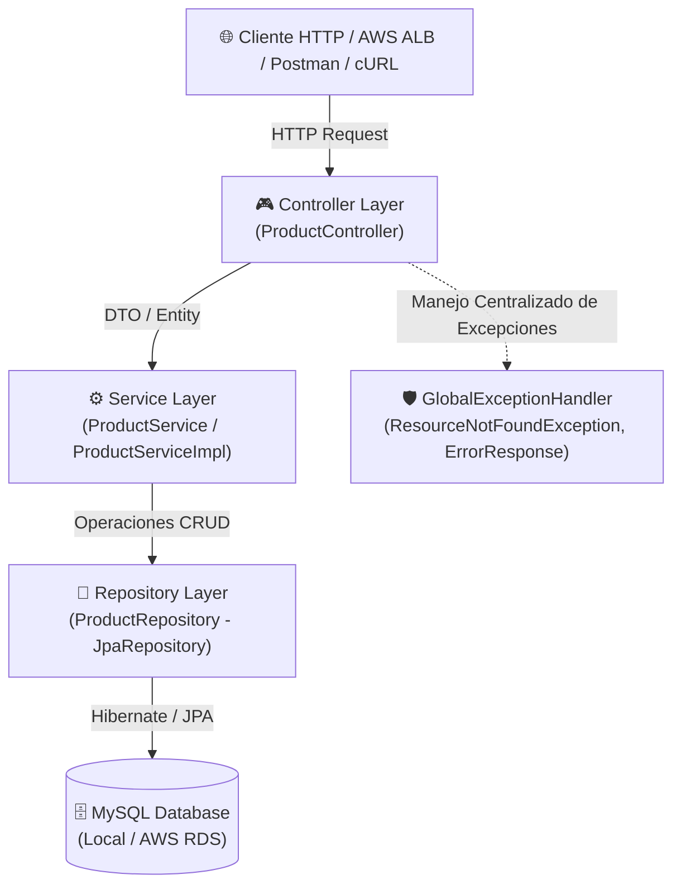
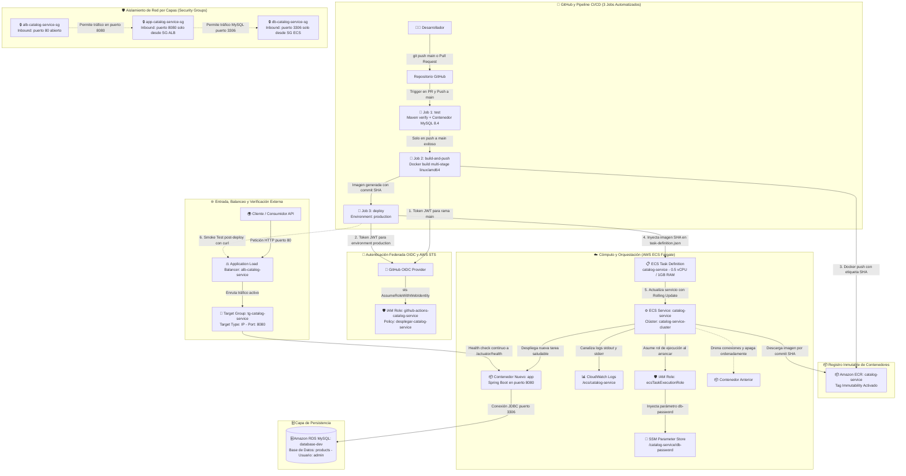

# 📦 Catalog Service API - Base Lab AWS & GitHub Actions

Microservicio REST desarrollado en **Java** con **Spring Boot** para la gestión de un catálogo de productos. Este repositorio sirve como proyecto base para laboratorios de integración continua y despliegue continuo (**CI/CD**) mediante **GitHub Actions** hacia infraestructura en **Amazon Web Services (AWS)**.

---

## 🚀 1. Tecnologías Utilizadas

| Categoría | Tecnología / Herramienta | Versión / Detalle |
| :--- | :--- | :--- |
| **Lenguaje** | [Java](https://www.oracle.com/java/) | 21 (LTS) |
| **Framework Base** | [Spring Boot](https://spring.io/projects/spring-boot) | 4.1.2 |
| **Capa Web** | Spring MVC (`spring-boot-starter-webmvc`) | Creación de endpoints y controladores REST |
| **Persistencia / ORM** | Spring Data JPA / Hibernate | Mapeo objeto-relacional y consultas CRUD |
| **Base de Datos** | [MySQL](https://www.mysql.com/) | 8.x (Driver: `mysql-connector-j`) |
| **Pool de Conexiones** | HikariCP | Configurado con optimizaciones en perfil `prod` |
| **Manejo de Errores** | `@RestControllerAdvice` | Respuestas estandarizadas de excepciones |
| **Monitoreo / Salud** | Spring Boot Actuator | Probes de Liveness/Readiness (`/actuator/health`) para balanceadores AWS |
| **Productividad** | Lombok | Reducción de código repetitivo (Boilerplate) |
| **Gestor de Construcción**| Apache Maven | Incluye Maven Wrapper (`mvnw` / `mvnw.cmd`) |
| **Destino de Despliegue** | AWS (EC2 / ECS / App Runner / Elastic Beanstalk) | Integración con RDS MySQL y GitHub Actions |

---

## 🏛️ 2. Arquitectura de la Aplicación

La aplicación está diseñada bajo el patrón de **Arquitectura en Capas (Layered Architecture)**, asegurando la separación de responsabilidades y modularidad.

### 2.1 Diagrama de Capas del Software



### 2.2 Descripción de Capas

1. **Capa de Controladores (`com.icodeap.catalog.controller`)**:
   - `ProductController`: Expone los endpoints REST bajo la ruta `/api/v1/products`, mapea las peticiones HTTP, delega la lógica al servicio correspondiente y devuelve las respuestas con sus códigos HTTP estándar.
2. **Capa de Negocio / Servicios (`com.icodeap.catalog.service`)**:
   - `ProductService` & `ProductServiceImpl`: Gestionan las reglas de negocio, validaciones y la orquestación de operaciones de catálogo.
3. **Capa de Persistencia (`com.icodeap.catalog.repository`)**:
   - `ProductRepository`: Interfaz que extiende de `JpaRepository<Product, Long>`, permitiendo interactuar con la base de datos sin escribir SQL directo.
4. **Capa de Dominio / Entidades (`com.icodeap.catalog.entity`)**:
   - `Product`: Representa la tabla `products` en la base de datos con los atributos: `id`, `name`, `description`, `category`, `stock` y `active`.
5. **Capa de Excepciones (`com.icodeap.catalog.exception`)**:
   - `GlobalExceptionHandler`: Interceptor global con `@RestControllerAdvice` para capturar errores como `ResourceNotFoundException` o excepciones generales, respondiendo con una estructura uniforme (`ErrorResponse`).

### 2.3 Flujo de Despliegue CI/CD (GitHub Actions + AWS)

El siguiente diagrama detalla la interacción integral entre el pipeline automatizado en **GitHub Actions** (estructurado en 3 jobs secuenciales con validación OIDC) y la infraestructura completa en **AWS** (ECR, ECS Fargate, ALB, CloudWatch, Parameter Store y RDS MySQL) aprovisionada para el microservicio:



#### Fases del Ciclo de Vida del Despliegue:

1. **Validación y Pruebas Automatizadas en CI (`test`)**: Se dispara en cada Pull Request y en cada `push` a la rama principal (`main`). El runner de GitHub Actions aprovisiona un contenedor de servicio efímero de **MySQL 8.4** (`mysql:8.4`) y ejecuta `./mvnw verify`, garantizando que todas las pruebas unitarias y de persistencia se ejecuten contra un motor real sin tocar la nube de AWS ni dejar infraestructura huérfana.
2. **Autenticación Federada OIDC de Mínimo Privilegio**: GitHub Actions genera tokens web JSON (JWT) efímeros y firmados criptográficamente. Se valida el *Subject* (`sub`) exacto para cada etapa:
   - Para `build-and-push`: restringido a la rama `repo:USUARIO/REPO:ref:refs/heads/main`.
   - Para `deploy`: restringido al entorno `repo:USUARIO/REPO:environment:production`.
   AWS STS valida la firma mediante el proveedor OIDC y entrega credenciales temporales de sesión para el rol `github-actions-catalog-service`, eliminando completamente la necesidad de secretos estáticos (`AWS_ACCESS_KEY_ID` / `AWS_SECRET_ACCESS_KEY`).
3. **Construcción y Publicación Inmutable en Amazon ECR (`build-and-push`)**: Utilizando `docker/buildx` y `docker/build-push-action`, se construye la imagen para arquitectura `linux/amd64` y se publica en el repositorio privado de **Amazon ECR** (`catalog-service`). La imagen se etiqueta unívocamente con el SHA completo del commit (`${{ github.sha }}`). La política de **Tag Immutability** garantiza que ninguna imagen pueda sobrescribirse, permitiendo auditorías y *rollbacks* exactos y deterministas.
4. **Renderizado de Task Definition y Despliegue Progresivo (`deploy`)**: El job descarga el blueprint [`.aws/task-definition.json`](file:///D:/icodeap/code/prod/catalog/.aws/task-definition.json), inyecta la URI de la imagen recién publicada en el contenedor `app` y registra una nueva revisión en ECS. A continuación, actualiza el servicio `catalog-service` en el clúster `catalog-service-cluster`.
5. **Arranque Seguro en Fargate e Inyección de Secretos**: La nueva tarea se levanta en modo Serverless (0.5 vCPU / 1 GB RAM). El rol de ejecución `ecsTaskExecutionRole` descarga la imagen de ECR, lee de forma segura la contraseña desde **AWS Systems Manager Parameter Store** (`/catalog-service/db-password`) y la inyecta como variable de entorno `SPRING_DATASOURCE_PASSWORD` en la JVM sin exponerla en texto claro en repositorios ni consolas. Los logs estándar se canalizan hacia **CloudWatch Logs** (`/ecs/catalog-service`).
6. **Zero-Downtime Rolling Update y Circuit Breaker**: El **Target Group** (`tg-catalog-service`) sondea el probe de salud `/actuator/health` en el puerto `8080`. Mientras la JVM arranca y responde `HTTP 200 OK`, el balanceador (`alb-catalog-service`) continúa sirviendo el 100% del tráfico a la tarea previa. Una vez declarada sana, el balanceador redirige el tráfico hacia la nueva tarea y drena gradualmente las conexiones activas de la versión anterior antes de apagarla. Si la nueva versión falla al arrancar, el mecanismo de **Deployment Circuit Breaker** de ECS revierte el despliegue a la última revisión estable.
7. **Smoke Test Automatizado Post-Despliegue**: Tras alcanzar la estabilidad del servicio (`wait-for-service-stability: true`), GitHub Actions ejecuta un bucle de comprobación externa mediante `curl` contra la URL pública del balanceador (`http://${{ vars.ALB_DNS }}/actuator/health`). El pipeline solo se marca como exitoso si la aplicación responde operativamente desde Internet.
8. **Seguridad y Segmentación de Red por Capas**: El tráfico se controla rigurosamente mediante tres **Security Groups** acoplados:
   - `alb-catalog-service-sg`: Permite tráfico HTTP público en el puerto 80.
   - `app-catalog-service-sg`: Permite tráfico en el puerto 8080 **únicamente** originado desde el Security Group del ALB.
   - `db-catalog-service-sg`: Permite conexiones en el puerto 3306 **únicamente** originadas desde el Security Group de las tareas ECS. Ninguna entidad externa o pública puede conectarse directamente a la base de datos RDS.

---

## 📡 3. Endpoints Expuestos

La aplicación expone una API REST para la gestión de productos y endpoints de observabilidad para balanceadores de carga:

| Método | Endpoint | Descripción | Códigos HTTP |
| :--- | :--- | :--- | :--- |
| **POST** | `/api/v1/products` | Crea un nuevo producto en la base de datos | `201 Created`, `500 Internal Error` |
| **GET** | `/api/v1/products` | Obtiene la lista completa de productos | `200 OK`, `500 Internal Error` |
| **GET** | `/api/v1/products/{id}` | Obtiene los detalles de un producto por ID | `200 OK`, `404 Not Found` |
| **PUT** | `/api/v1/products/{id}` | Actualiza un producto existente | `200 OK`, `404 Not Found` |
| **DELETE** | `/api/v1/products/{id}` | Elimina un producto por ID | `204 No Content`, `404 Not Found` |
| **GET** | `/actuator/health` | Health Check y Probes de salud (AWS ALB / ECS) | `200 OK` |

### Modelo de Datos del Producto (`Product`)

```json
{
  "name": "Teclado Mecánico RGB",
  "description": "Teclado mecánico con switches red",
  "category": "Periféricos",
  "stock": 50,
  "active": true
}
```

---

## 💻 4. Ejemplos de Pruebas con cURL

Asegúrate de ajustar la variable de host según el entorno:
- Local: `http://localhost:8080`
- AWS (ALB / Instancia): `http://<TU_IP_O_DNS_AWS>:8080`

### 4.1 Health Check (Spring Boot Actuator)
Verifica el estado del servicio (ideal para configurar el Target Group del ALB de AWS):
```bash
curl -X GET http://localhost:8080/actuator/health
```
*Respuesta esperada:*
```json
{"status":"UP"}
```

---
### 4.2 Crear un Producto (`POST /api/v1/products`)
```bash
curl -X POST http://localhost:8080/api/v1/products \
  -H "Content-Type: application/json" \
  -d '{
    "name": "Laptop Gamer Pro",
    "description": "Portátil de alta gama con procesador Core i7 y 32GB RAM",
    "category": "Computadoras",
    "stock": 15,
    "active": true
  }'
```
*Respuesta esperada (HTTP 201 Created):*
```json
{
  "id": 1,
  "name": "Laptop Gamer Pro",
  "description": "Portátil de alta gama con procesador Core i7 y 32GB RAM",
  "category": "Computadoras",
  "stock": 15,
  "active": true
}
```

---
### 4.3 Listar Todos los Productos (`GET /api/v1/products`)
```bash
curl -X GET http://localhost:8080/api/v1/products
```
*Respuesta esperada (HTTP 200 OK):*
```json
[
  {
    "id": 1,
    "name": "Laptop Gamer Pro",
    "description": "Portátil de alta gama con procesador Core i7 y 32GB RAM",
    "category": "Computadoras",
    "stock": 15,
    "active": true
  }
]
```

---

### 4.4 Obtener Producto por ID (`GET /api/v1/products/{id}`)
```bash
curl -X GET http://localhost:8080/api/v1/products/1
```

Si el producto no existe:
```bash
curl -X GET http://localhost:8080/api/v1/products/999
```
*Respuesta esperada (HTTP 404 Not Found):*
```json
{
  "status": 404,
  "message": "Producto no encontrado con el ID: 999",
  "timestamp": "2026-10-24T10:00:00.000"
}
```

---

### 4.5 Actualizar un Producto (`PUT /api/v1/products/{id}`)
```bash
curl -X PUT http://localhost:8080/api/v1/products/1 \
  -H "Content-Type: application/json" \
  -d '{
    "name": "Laptop Gamer Pro Ultra",
    "description": "Portátil actualizada a 64GB RAM y pantalla OLED",
    "category": "Computadoras",
    "stock": 10,
    "active": true
  }'
```

---

### 4.6 Eliminar un Producto (`DELETE /api/v1/products/{id}`)
```bash
curl -X DELETE http://localhost:8080/api/v1/products/1
```
*Respuesta esperada (HTTP 204 No Content).*

---

## 🛠️ 5. Instrucciones para Levantado Local

### 5.1 Prerrequisitos
- **Java Development Kit (JDK)**: Versión 21 instalada (`java -version`).
- **Base de Datos MySQL**: Instancia local o contenedor Docker en el puerto `3306`.
- **Git** instalado.

---

### 5.2 Levantar la Base de Datos con Docker (Recomendado)
Para disponer rápidamente de una base de datos MySQL 8 local:

```bash
docker run -d \
  --name catalog-mysql \
  -p 3306:3306 \
  -e MYSQL_ROOT_PASSWORD=root \
  -e MYSQL_DATABASE=catalog_db \
  mysql:8.0
```

---

### 5.3 Compilar y Empaquetar el Proyecto

En **Windows (PowerShell / CMD)**:
```cmd
.\mvnw.cmd clean package -DskipTests
```

En **Linux / macOS**:
```bash
./mvnw clean package -DskipTests
```

Esto generará el archivo `.jar` ejecutable dentro de la carpeta `target/`:
`target/catalog-0.0.1-SNAPSHOT.jar`

---

### 5.4 Ejecución de la Aplicación

#### Opción A: Ejecutar mediante Maven Wrapper (Entorno de Desarrollo)
Con perfil `dev` activado (muestra logs SQL detallados):

*En Windows:*
```cmd
.\mvnw.cmd spring-boot:run -Dspring-boot.run.profiles=dev
```

*En Linux / macOS:*
```bash
./mvnw spring-boot:run -Dspring-boot.run.profiles=dev
```

#### Opción B: Ejecutar mediante archivo JAR empaquetado (Recomendado para Producción / Docker / AWS)
```bash
java -jar target/catalog-0.0.1-SNAPSHOT.jar --spring.profiles.active=prod
```

#### Opción C: Ejecutar pasando variables de entorno personalizadas (e.g., apuntando a AWS RDS)
```bash
export SPRING_DATASOURCE_URL="jdbc:mysql://mi-rds-cluster.us-east-1.rds.amazonaws.com:3306/catalog_db"
export SPRING_DATASOURCE_USERNAME="admin"
export SPRING_DATASOURCE_PASSWORD="MiPasswordSegura"
export PORT=8080

java -jar target/catalog-0.0.1-SNAPSHOT.jar
```

---

## ☁️ 6. Servicios de AWS Utilizados en el Laboratorio (ECR + ECS Fargate + ALB + RDS)

Esta sección proporciona una guía conceptual y práctica exhaustiva de cada servicio de **Amazon Web Services (AWS)** que conforma la infraestructura de despliegue automatizado. Su objetivo es que el estudiante adquiera una comprensión clara de la arquitectura antes de iniciar la configuración práctica.

### 🗺️ Matriz General de Servicios

| Servicio AWS | Categoría | Función Principal en la Práctica | ¿Dónde se Configura / Administra? |
| :--- | :--- | :--- | :--- |
| **Amazon ECR** | Registro de Contenedores | Repositorio privado para almacenar las imágenes Docker versionadas | Consola ECR / GitHub Actions (`docker push`) |
| **Amazon EC2 (Security Groups)** | Red & Seguridad | Cortafuegos virtuales por capas (ALB, ECS Tasks y RDS) | Consola VPC / EC2 (Security Groups) |
| **Amazon CloudWatch Logs** | Monitoreo & Logs | Centralización y consulta de logs en vivo de los contenedores | Consola CloudWatch (`awslogs` log driver) |
| **AWS Systems Manager (SSM)** | Configuración & Secretos | Almacenar credenciales seguras de DB (`Parameter Store`) | Consola Systems Manager (`SecureString`) |
| **Amazon RDS MySQL** | Base de Datos Relacional | Instancia de MySQL administrada en subred privada | Consola RDS (Database Instance) |
| **Target Group & ALB** | Balanceo & Red | Entrada pública por puerto 80 y health check a `/actuator/health` | Consola EC2 (Load Balancers & Target Groups) |
| **Amazon ECS (Clúster & Fargate)**| Cómputo Serverless | Ejecución y orquestación de contenedores sin gestionar servidores | Consola ECS (Clusters) |
| **AWS IAM (Roles)** | Identidad & Permisos | Permisos mínimos para descarga de ECR, logs y OIDC de GitHub | Consola IAM (Roles & Policies) |
| **Task Definition & ECS Service**| Definición & Orquestación | Plano del contenedor y gestor del ciclo de vida (rolling update) | Consola ECS / Pipeline GitHub Actions |
| **OIDC (OpenID Connect)** | Federación & CI/CD | Autenticación temporal y segura entre GitHub Actions y AWS | Consola IAM (Identity Providers) |

---

### 📘 Detalle Conceptual y Práctico por Servicio

#### 1. 📦 Amazon ECR (Elastic Container Registry)
- **¿Qué es?**:  
  Es un registro de contenedores Docker totalmente administrado, seguro y de alto rendimiento proporcionado por AWS, equivalente empresarial a Docker Hub pero integrado nativamente con el control de accesos de AWS IAM.
- **¿Para qué se usa en el laboratorio?**:
  - **Repositorio privado**: Se crea un repositorio específico (ej. `catalog-service`) para almacenar de forma privada las imágenes Docker del microservicio.
  - **Primera imagen base**: Permite compilar y subir manualmente la primera imagen de prueba (`:v1.0.0` o `:latest`) para verificar el funcionamiento del contenedor y la conectividad antes de delegar todo al pipeline.
  - **Receptor del Pipeline CI/CD**: En cada `git push` a `main`, GitHub Actions construye la imagen mediante el [Dockerfile](file:///D:/icodeap/code/prod/catalog/Dockerfile) y ejecuta `docker push` etiquetando la imagen con el identificador del commit (`${{ github.sha }}`).

---

#### 2. 🛡️ Amazon EC2 - Security Groups (Grupos de Seguridad)
- **¿Qué es?**:  
  Son cortafuegos (*firewalls*) virtuales con estado (*stateful*) que actúan a nivel de interfaz de red elástica (ENI). Filtran el tráfico entrante (*inbound*) y saliente (*outbound*) basándose en protocolos, puertos y orígenes IP o referencias cruzadas entre grupos de seguridad.
- **¿Para qué se usa en el laboratorio?**:
  Implementar la arquitectura de seguridad por capas (**Defensa en Profundidad**) garantizando que ningún componente esté expuesto innecesariamente:
  1. **Security Group del ALB (`alb-catalog-service-sg`)**:
     - *Inbound*: Puerto `80` (HTTP) abierto a todo Internet (`0.0.0.0/0`).
     - *Outbound*: Todo el tráfico saliente permitido hacia las tareas ECS.
  2. **Security Group de las Tareas ECS Fargate (`app-catalog-service-sg`)**:
     - *Inbound*: Puerto `8080` (Spring Boot) permitido **únicamente** desde el Security Group del ALB (`sg-catalog-alb`). No tiene acceso directo desde Internet.
     - *Outbound*: Hacia RDS en el puerto `3306`, y hacia Internet (mediante NAT Gateway o endpoints) para descargar imágenes de ECR y enviar logs a CloudWatch.
  3. **Security Group de la Base de Datos RDS MySQL (`db-catalog-service-sg`)**:
     - *Inbound*: Puerto `3306` (MySQL) permitido **exclusivamente** desde el Security Group de las Tareas ECS (`sg-catalog-ecs`). El acceso desde Internet está estrictamente bloqueado.

---

#### 3. 📊 Amazon CloudWatch (CloudWatch Logs)
- **¿Qué es?**:  
  Es el servicio centralizado de observabilidad, telemetría y monitoreo de AWS. Recolecta logs, métricas operacionales y permite configurar alarmas e información en tiempo real de los servicios en la nube.
- **¿Para qué se usa en el laboratorio?**:
  - **Visualización de logs de Spring Boot**: Los contenedores Fargate no permiten acceso tradicional por SSH; por ello, la Task Definition configura el controlador `awslogs` para redirigir la salida de consola (`stdout`/`stderr`) directamente a un grupo de logs en CloudWatch (ej. `/ecs/catalog-service`).
  - **Depuración en tiempo de ejecución**: El estudiante puede revisar el stacktrace completo si la aplicación falla al conectar con MySQL, si HikariCP agota conexiones o si Hibernate encuentra errores de esquema.
  - **Supervisión de recursos**: Permite inspeccionar gráficos de uso de CPU y memoria de las tareas para optimizar el dimensionamiento de Fargate.

---

#### 4. 🔐 AWS Systems Manager (SSM) - Parameter Store
- **¿Qué es?**:  
  Es un almacén seguro y jerárquico para almacenar variables de configuración y secretos (claves de API, credenciales de base de datos, contraseñas) con capacidades de cifrado mediante **AWS Key Management Service (AWS KMS)**.
- **¿Para qué se usa en el laboratorio?**:
  - **Eliminación de credenciales en código**: En lugar de incluir credenciales de base de datos en [application-prod.yaml](file:///D:/icodeap/code/prod/catalog/src/main/resources/application-prod.yaml) o en variables de GitHub en texto claro, se crean parámetros seguros en SSM:
    - `/prod/catalog/SPRING_DATASOURCE_URL` (Tipo `String`)
    - `/prod/catalog/SPRING_DATASOURCE_USERNAME` (Tipo `String`)
    - `/prod/catalog/SPRING_DATASOURCE_PASSWORD` (Tipo `SecureString` cifrado con KMS)
  - **Inyección nativa en ECS**: En la Task Definition, se referencian estos parámetros mediante la directiva `secrets`. Al instanciar el contenedor, ECS los descifra en memoria y los pasa como variables de entorno al proceso Java de forma transparente.

---

#### 5. 🗄️ Amazon RDS MySQL (Relational Database Service)
- **¿Qué es?**:  
  Es un servicio completamente administrado de bases de datos relacionales que automatiza el aprovisionamiento de hardware, la configuración de la base de datos, los parches del motor, las copias de seguridad continuas y la tolerancia a fallos.
- **¿Para qué se usa en el laboratorio?**:
  - **Persistencia de la entidad `Product`**: Proporciona la instancia MySQL 8.x dedicada donde se crea la base de datos `catalog_db`.
  - **Aislamiento en subred privada**: La instancia RDS se aloja en subredes privadas (*Private Subnets*) dentro de una VPC, de modo que no posee dirección IP pública y únicamente dialoga con las tareas Fargate autorizadas.

---

#### 6. ⚖️ Target Group y Application Load Balancer (ALB - EC2)
- **¿Qué es?**:  
  - **Application Load Balancer (ALB)**: Balanceador de carga de Capa 7 (Aplicación) que examina el tráfico HTTP/HTTPS entrante y lo distribuye uniformemente entre múltiples destinos.
  - **Target Group (Grupo de Destino)**: Enrutador lógico que asocia el balanceador con los destinos finales (en el caso de Fargate, las direcciones IP privadas de los contenedores) y monitorea su salud.
- **¿Para qué se usa en el laboratorio?**:
  - **Punto único de entrada (DNS público)**: Brinda a los clientes externos una URL estable para consumir la API en el puerto estándar `80`.
  - **Chequeos de Salud (Health Checks)**: El Target Group consulta constantemente la ruta `/actuator/health` en el puerto `8080`. Si una tarea de ECS falla o está arrancando la JVM, el ALB suspende el tráfico hacia ella hasta que devuelva `HTTP 200`.
  - **Despliegues sin caída de servicio**: Durante un despliegue continuo, el ALB garantiza que el tráfico nuevo sólo fluya a los contenedores que han superado con éxito el health check.

---

#### 7. 🚀 Clúster ECS y Modo AWS Fargate
- **¿Qué es?**:  
  **Amazon Elastic Container Service (ECS)** es el orquestador nativo de AWS para administrar clústeres de contenedores Docker. **AWS Fargate** es la tecnología de cómputo *Serverless* para ECS que ejecuta contenedores sin necesidad de administrar servidores virtuales EC2 subyacentes.
- **¿Para qué se usa en el laboratorio?**:
  - **Clúster ECS**: Actúa como el límite lógico organizador del laboratorio (ej. `catalog-cluster`) donde se registran los servicios y tareas.
  - **Fargate**: Elimina la sobrecarga operacional de aprovisionar instancias EC2, configurar demonios Docker o instalar parches del sistema operativo. El estudiante solo especifica la vCPU (ej. 0.25) y la memoria RAM (ej. 0.5 GB) requerida por el contenedor Spring Boot.

---

#### 8. 🛡️ AWS IAM (Identity and Access Management) y Roles
- **¿Qué es?**:  
  Es el servicio fundamental de AWS que controla quién está autenticado y autorizado para interactuar con los recursos de la nube mediante políticas (*policies*) de permisos mínimos.
- **¿Para qué se usa en el laboratorio?**:
  Comprender y diferenciar los roles involucrados en la ejecución de contenedores:
  - **ECS Task Execution Role (`ecsTaskExecutionRole`)**:
    - **Quién lo usa**: El propio agente interno de AWS ECS/Fargate *antes* de levantar el código de usuario.
    - **Permisos requeridos**:
      1. Descargar la imagen Docker desde **Amazon ECR** (`ecr:GetDownloadUrlForLayer`, `ecr:BatchGetImage`, `ecr:GetAuthorizationToken`).
      2. Crear y escribir eventos en los logs de **Amazon CloudWatch** (`logs:CreateLogStream`, `logs:PutLogEvents`).
      3. Leer parámetros y desencriptar secretos de **AWS Systems Manager (SSM)** (`ssm:GetParameters`, `kms:Decrypt`).
  - **ECS Task Role**:
    - **Quién lo usa**: El proceso Java dentro del contenedor mientras la aplicación está corriendo.
    - **Permisos requeridos**: Ninguno en este laboratorio base (la app sólo habla con RDS vía TCP), pero se usa si la API requiere acceder a S3, SQS o DynamoDB sin credenciales quemadas.
  - **GitHub Actions IAM Role**:
    - Rol asumido por el pipeline mediante OIDC para interactuar con ECR y ECS.

---

#### 9. 📋 Task Definition y ECS Service
- **¿Qué es?**:  
  - **Task Definition (Definición de Tarea)**: Es el documento JSON/blueprint que especifica detalladamente los parámetros del contenedor: imagen Docker, arquitectura de CPU/SO, asignación de recursos (CPU/RAM), puertos expuestos (`8080`), variables de entorno, secretos (SSM) y configuración de logs (CloudWatch).
  - **ECS Service (Servicio ECS)**: Es el controlador encargado de mantener en ejecución el número deseado de copias de la Task Definition (`desiredCount`), reiniciar tareas en caso de fallo, orquestar despliegues continuos (*Rolling Updates*) y sincronizarse con el Target Group del ALB.
- **¿Para qué se usa en el laboratorio?**:
  - La **Task Definition** define el entorno de ejecución para el JAR de Spring Boot (imagen de ECR, puerto 8080, variables de entorno y secrets de base de datos).
  - El **ECS Service** asegura alta disponibilidad, registra las tareas en el balanceador de carga y reemplaza automáticamente los contenedores antiguos con los nuevos cuando GitHub Actions emite un nuevo despliegue.

---

#### 10. 🔑 OIDC (OpenID Connect) con GitHub Actions e IAM
- **¿Qué es?**:  
  Es un protocolo de federación de identidades sobre OAuth 2.0 que permite a GitHub Actions solicitar tokens de autenticación web JSON (JWT) de vida corta reconocidos por AWS IAM.
- **¿Para qué se usa en el laboratorio?**:
  - **Seguridad Moderna y Profesional (Sin Llaves Estáticas)**: Elimina la necesidad de almacenar `AWS_ACCESS_KEY_ID` y `AWS_SECRET_ACCESS_KEY` de larga duración en los secretos del repositorio de GitHub.
  - **Autenticación Temporal**: Al iniciar el workflow, GitHub genera un token OIDC criptográficamente firmado. AWS IAM valida la firma con el emisor (`token.actions.githubusercontent.com`) y entrega credenciales temporales de sesión válidas por unos minutos mediante la acción `aws-actions/configure-aws-credentials`.
  - **Control de Acceso Basado en Repositorio**: La política de confianza (*Trust Policy*) de IAM puede restringir el acceso exclusivamente al repositorio y rama del laboratorio (ej. `repo:usuario/catalog:ref:refs/heads/main`), asegurando que ningún otro repositorio pueda asumir el rol.

---

### 6.3 Convenciones y Nomenclatura Estándar del Laboratorio

Para garantizar la coherencia absoluta entre la infraestructura aprovisionada en AWS, la configuración de Spring Boot y el pipeline de GitHub Actions, se utilizan los siguientes identificadores canónicos:

| Recurso / Componente | Nombre / Valor Estándar | Ámbito y Relevancia |
| :--- | :--- | :--- |
| **Región de AWS** | `us-east-1` (N. Virginia) | Consola AWS, AWS CLI y variable `AWS_REGION` del pipeline |
| **Repositorio ECR** | `catalog-service` | Almacén privado de imágenes Docker (con *Tag Immutability* activo) |
| **Clúster ECS** | `catalog-service-cluster` | Clúster Serverless de AWS Fargate |
| **Servicio ECS** | `catalog-service` | Orquestador de tareas Fargate con despliegue en Rolling Update |
| **Nombre del Contenedor** | `app` | Identificador en [`.aws/task-definition.json`](file:///D:/icodeap/code/prod/catalog/.aws/task-definition.json) y variable `CONTAINER_NAME` en CI/CD |
| **Familia de Task Definition** | `catalog-service` | Definición de tarea versionada en ECS |
| **Security Groups** | `alb-catalog-service-sg`<br/>`app-catalog-service-sg`<br/>`db-catalog-service-sg` | Cortafuegos en 3 capas de aislamiento: ALB (80) → Fargate (8080) → RDS (3306) |
| **Target Group** | `tg-catalog-service` | Tipo IP, puerto 8080, health check en `/actuator/health` |
| **Application Load Balancer** | `alb-catalog-service` | Balanceador público HTTP en puerto 80 conectado a Internet |
| **Grupo de Logs CloudWatch** | `/ecs/catalog-service` | Destino de logs stdout/stderr bajo el driver `awslogs` |
| **Parámetro SSM (Parameter Store)** | `/catalog-service/db-password` | Tipo `SecureString` con la contraseña de la base de datos |
| **Instancia RDS MySQL** | `database-dev` | Instancia administrada de MySQL 8.x en subred privada |
| **Base de Datos Inicial** | `products` | Nombre de la base de datos creada en RDS |
| **Usuario Maestro RDS** | `admin` | Usuario administrador de la base de datos |
| **Rol de Ejecución ECS** | `ecsTaskExecutionRole` | Rol para Fargate con permisos para ECR, CloudWatch y lectura de SSM |
| **Rol IAM para GitHub Actions** | `github-actions-catalog-service` | Rol asumido vía OIDC con la política `desplegar-catalog-service` |
| **GitHub Environment** | `production` | Entorno en GitHub para gobernar el job `deploy` y OIDC |
| **Variable de Repositorio** | `ALB_DNS` | DNS público del ALB (sin `http://`) para el Smoke Test automatizado |
| **Secreto de Repositorio** | `AWS_ROLE_ARN` | ARN del rol IAM asumido por GitHub Actions mediante OIDC |

---

## 🐳 7. Cómo Subir la Imagen Inicial a Amazon ECR (Bootstrap Manual)

Antes de activar el pipeline automatizado, es necesario subir manualmente una primera imagen (`catalog-service:v1`) para permitir que el servicio ECS arranque por primera vez durante la configuración de infraestructura (Paso 1 de la [guia-consola-ecr-ecs-alb2_6.md](file:///D:/icodeap/code/prod/catalog/guia-consola-ecr-ecs-alb2_6.md)):

```bash
# 1. Autenticarse contra el registro privado de Amazon ECR
aws ecr get-login-password --region us-east-1 | docker login --username AWS --password-stdin <ACCOUNT_ID>.dkr.ecr.us-east-1.amazonaws.com

# 2. Compilar la imagen Docker para la arquitectura x86_64 requerida por Fargate
docker build --platform linux/amd64 -t catalog-service:v1 . (solo si es mac)

docker build -t <ACCOUNT_ID>.dkr.ecr.us-east-1.amazonaws.com/catalog-service:v1 .

# 3. Publicar la imagen inicial en Amazon ECR
docker push <ACCOUNT_ID>.dkr.ecr.us-east-1.amazonaws.com/catalog-service:v1
```

> [!NOTE]
> Se utiliza la etiqueta `:v1` y no `:latest` porque el repositorio ECR tiene activado **Tag Immutability**. Una vez completado este arranque inicial, todas las publicaciones subsiguientes las gestiona automáticamente el pipeline de GitHub Actions etiquetando con el commit SHA (`${{ github.sha }}`).

---

## ⚙️ 8. Especificación del Pipeline CI/CD Automatizado (`.github/workflows/ci-cd.yml`)

El pipeline completo de integración y despliegue continuo se organiza en **tres jobs independientes y secuenciales**, siguiendo las mejores prácticas de seguridad, aislamiento de permisos y verificación de extremo a extremo:

```yaml
name: CI/CD

on:
  pull_request:
    branches: [main]
  push:
    branches: [main]

permissions:
  contents: read

env:
  AWS_REGION: us-east-1
  ECR_REPOSITORY: catalog-service
  ECS_CLUSTER: catalog-service-cluster
  ECS_SERVICE: catalog-service
  CONTAINER_NAME: app
  TASK_DEFINITION: .aws/task-definition.json

jobs:
  # =========================================================================
  # JOB 1: Compilación y Pruebas Unitarias/Integración con MySQL Aislado
  # =========================================================================
  test:
    runs-on: ubuntu-latest
    services:
      mysql:
        image: mysql:8.4
        env:
          MYSQL_ROOT_PASSWORD: ci-root-pass
          MYSQL_DATABASE: products
          MYSQL_USER: app
          MYSQL_PASSWORD: ci-app-pass
        ports:
          - 3306:3306
        options: >-
          --health-cmd="mysqladmin ping -h 127.0.0.1 -uroot -pci-root-pass --silent"
          --health-interval=5s
          --health-timeout=5s
          --health-retries=20
    env:
      SPRING_DATASOURCE_URL: jdbc:mysql://localhost:3306/products?allowPublicKeyRetrieval=true&useSSL=false
      SPRING_DATASOURCE_USERNAME: app
      SPRING_DATASOURCE_PASSWORD: ci-app-pass
    steps:
      - uses: actions/checkout@v6

      - uses: actions/setup-java@v5
        with:
          distribution: temurin
          java-version: '21'

      - name: Pruebas automatizadas
        run: ./mvnw -B verify

  # =========================================================================
  # JOB 2: Construcción de Imagen Docker y Publicación Inmutable en Amazon ECR
  # =========================================================================
  build-and-push:
    needs: test
    if: github.event_name == 'push'
    runs-on: ubuntu-latest
    permissions:
      contents: read
      id-token: write
    outputs:
      image: ${{ steps.meta.outputs.image }}
    steps:
      - uses: actions/checkout@v6

      - name: Autenticación en AWS mediante OIDC (Rama main)
        uses: aws-actions/configure-aws-credentials@v6
        with:
          role-to-assume: ${{ secrets.AWS_ROLE_ARN }}
          aws-region: ${{ env.AWS_REGION }}

      - name: Login en Amazon ECR
        id: login-ecr
        uses: aws-actions/amazon-ecr-login@v2

      - name: Generar URI de Imagen con Commit SHA
        id: meta
        run: echo "image=${{ steps.login-ecr.outputs.registry }}/${{ env.ECR_REPOSITORY }}:${{ github.sha }}" >> "$GITHUB_OUTPUT"

      - uses: docker/setup-buildx-action@v4

      - name: Construir y Publicar Imagen Docker
        uses: docker/build-push-action@v7
        with:
          context: .
          platforms: linux/amd64
          push: true
          tags: ${{ steps.meta.outputs.image }}
          provenance: false

  # =========================================================================
  # JOB 3: Renderizado de Task Definition, Rolling Update en ECS y Smoke Test
  # =========================================================================
  deploy:
    needs: build-and-push
    runs-on: ubuntu-latest
    environment: production
    concurrency:
      group: deploy-production
      cancel-in-progress: false
    permissions:
      contents: read
      id-token: write
    steps:
      - uses: actions/checkout@v6

      - name: Autenticación en AWS mediante OIDC (Entorno production)
        uses: aws-actions/configure-aws-credentials@v6
        with:
          role-to-assume: ${{ secrets.AWS_ROLE_ARN }}
          aws-region: ${{ env.AWS_REGION }}

      - name: Inyectar nueva imagen en Task Definition
        id: render
        uses: aws-actions/amazon-ecs-render-task-definition@v1
        with:
          task-definition: ${{ env.TASK_DEFINITION }}
          container-name: ${{ env.CONTAINER_NAME }}
          image: ${{ needs.build-and-push.outputs.image }}

      - name: Desplegar en Amazon ECS (Fargate)
        uses: aws-actions/amazon-ecs-deploy-task-definition@v2
        with:
          task-definition: ${{ steps.render.outputs.task-definition }}
          service: ${{ env.ECS_SERVICE }}
          cluster: ${{ env.ECS_CLUSTER }}
          wait-for-service-stability: true
          wait-for-minutes: 10

      - name: Smoke Test post-despliegue (Verificación ALB)
        run: |
          for i in $(seq 1 12); do
            if curl -fsS -m 5 "http://${{ vars.ALB_DNS }}/actuator/health" | grep -q '"status":"UP"'; then
              echo "✅ Despliegue validado exitosamente: la aplicación responde UP a través del ALB."
              exit 0
            fi
            echo "Intento $i: esperando respuesta satisfactoria del ALB..."
            sleep 10
          done
          echo "❌ Error: El Smoke Test falló después de 12 intentos."
          exit 1
```

---

## 📋 9. Blueprint de la ECS Task Definition (`.aws/task-definition.json`)

La definición de tarea para ECS Fargate se almacena en el control de versiones bajo [`.aws/task-definition.json`](file:///D:/icodeap/code/prod/catalog/.aws/task-definition.json). Se define limpia y desacoplada de metadatos de solo lectura de AWS para facilitar su renderizado dinámico en CI/CD:

```json
{
  "family": "catalog-service",
  "networkMode": "awsvpc",
  "requiresCompatibilities": ["FARGATE"],
  "cpu": "512",
  "memory": "1024",
  "runtimePlatform": {
    "cpuArchitecture": "X86_64",
    "operatingSystemFamily": "LINUX"
  },
  "executionRoleArn": "arn:aws:iam::<ACCOUNT_ID>:role/ecsTaskExecutionRole",
  "containerDefinitions": [
    {
      "name": "app",
      "image": "<ACCOUNT_ID>.dkr.ecr.us-east-1.amazonaws.com/catalog-service:v1",
      "essential": true,
      "portMappings": [
        { "containerPort": 8080, "protocol": "tcp" }
      ],
      "environment": [
        { "name": "SPRING_DATASOURCE_URL", "value": "jdbc:mysql://<RDS_ENDPOINT>:3306/products" },
        { "name": "SPRING_DATASOURCE_USERNAME", "value": "admin" }
      ],
      "secrets": [
        {
          "name": "SPRING_DATASOURCE_PASSWORD",
          "valueFrom": "arn:aws:ssm:us-east-1:<ACCOUNT_ID>:parameter/catalog-service/db-password"
        }
      ],
      "logConfiguration": {
        "logDriver": "awslogs",
        "options": {
          "awslogs-group": "/ecs/catalog-service",
          "awslogs-region": "us-east-1",
          "awslogs-stream-prefix": "ecs"
        }
      }
    }
  ]
}
```

> [!IMPORTANT]
> - **Dimensionamiento de Memoria**: Se configuran `1024 MB` de RAM y `512` de CPU (0.5 vCPU). Asignar solo 512 MB a Spring Boot suele provocar la terminación abrupta del proceso por el OOM-Killer de Linux (`Exit Code 137`).
> - **Inyección de Secretos**: La directiva `secrets` delega en el agente de Fargate la tarea de leer y descifrar el parámetro desde SSM Parameter Store al momento de crear el contenedor, mapeándolo a la variable de entorno `SPRING_DATASOURCE_PASSWORD`.

---

## 🐳 10. Entorno Local Completo con Docker Compose

Para replicar localmente la misma arquitectura y validar el microservicio antes de cualquier interacción con AWS, se utiliza un archivo [`docker-compose.yml`](file:///D:/icodeap/code/prod/catalog/docker-compose.yml) en la raíz:

```yaml
services:
  db:
    image: mysql:8.4
    container_name: catalog-service-db
    environment:
      MYSQL_ROOT_PASSWORD: local-root-pass
      MYSQL_DATABASE: products
      MYSQL_USER: app
      MYSQL_PASSWORD: local-app-pass
    ports:
      - "3306:3306"
    volumes:
      - catalog-service-db-data:/var/lib/mysql
    healthcheck:
      test: ["CMD-SHELL", "mysqladmin ping -h 127.0.0.1 -uroot -p$$MYSQL_ROOT_PASSWORD --silent"]
      interval: 5s
      timeout: 5s
      retries: 20

  app:
    build: .
    container_name: catalog-service-app
    depends_on:
      db:
        condition: service_healthy
    environment:
      SPRING_DATASOURCE_URL: jdbc:mysql://db:3306/products?allowPublicKeyRetrieval=true&useSSL=false
      SPRING_DATASOURCE_USERNAME: app
      SPRING_DATASOURCE_PASSWORD: local-app-pass
    ports:
      - "8080:8080"

volumes:
  catalog-service-db-data:
```

### Comandos de Ejecución y Validación Local:
```bash
# Iniciar servicios con compilación de contenedor
docker compose up --build

# Verificar que el health check responda UP
curl -i http://localhost:8080/actuator/health

# Comprobar la creación automática de tablas en MySQL por Hibernate
docker exec catalog-service-db mysql -uapp -plocal-app-pass products -e "SHOW TABLES;"

# Detener los servicios
docker compose down
```

---

## 🔍 11. Matriz de Diagnóstico y Errores Frecuentes (Troubleshooting)

Esta tabla condensa las incidencias más comunes documentadas durante las fases de configuración manual y ejecución en CI/CD:

| Síntoma o Error | Causa Raíz Probable | Solución Comprobada |
| :--- | :--- | :--- |
| `mvnw: Permission denied` | En entornos Windows, el wrapper de Maven pierde el bit de ejecución en Git al confirmarse. | Ejecutar en terminal: `git update-index --chmod=+x mvnw`, realizar commit y push. |
| `Not authorized to perform sts:AssumeRoleWithWebIdentity` | Desajuste en el `sub` de la *Trust Policy* del rol de IAM (repositorios creados con formato `@OWNER_ID/@REPO_ID` vs clásico, mayúsculas en `USUARIO/REPO`, o discrepancia en el nombre del environment `production`). | Verificar la condición `StringLike` en el rol IAM. Obtener los IDs reales con `gh api repos/USUARIO/REPO --jq "{repo_id: .id, owner_id: .owner.id}"` y ajustar la política. |
| `ImageTagAlreadyExistsException` | Se ejecutó *Re-run all jobs* en GitHub Actions para un commit ya publicado con *Tag Immutability* activo en ECR. | Utilizar *Re-run failed jobs* (para reintentar únicamente el paso fallido reutilizando la imagen ya subida) o generar un nuevo commit. |
| `ResourceInitializationError: unable to pull secrets` | El rol `ecsTaskExecutionRole` carece de permisos de lectura sobre SSM Parameter Store. | Agregar la *inline policy* `leer-secretos-catalog-service` con la acción `ssm:GetParameters` sobre el recurso exacto `arn:aws:ssm:us-east-1:<ACCOUNT_ID>:parameter/catalog-service/*`. |
| `Communications link failure` | El contenedor Spring Boot intentó conectar a MySQL antes de que estuviera listo, o usó `localhost` dentro de una red de contenedores. | En local/CI, asegurar el `healthcheck` de MySQL y usar el nombre del host adecuado (`db` o `localhost` según aplique). En AWS, verificar que el Security Group de RDS acepte tráfico desde el Security Group de ECS en el puerto 3306. |
| `Target is in an Availability Zone that is not enabled for the load balancer` | El servicio ECS fue configurado con subredes de zonas de disponibilidad donde el ALB no tiene presencia. | Editar la configuración de red del servicio ECS para que sus subredes coincidan estrictamente con las zonas asignadas al ALB. |
| Tarea de ECS terminada con `Exit Code 137` | La JVM superó el límite de memoria RAM configurado en Fargate (OOM Killer). | Incrementar la memoria en la Task Definition a `1024 MB` y mantener `-XX:MaxRAMPercentage=75` en el `ENTRYPOINT`. |
| `Task definition file does not exist: .aws/task-definition.json` | La carpeta se nombró `aws` sin el punto inicial, o no se incluyó el paso `actions/checkout` en el job `deploy`. | Renombrar la carpeta exactamente a `.aws` y asegurar `actions/checkout@v6` en el job. |

---

## 🧹 12. Procedimiento de Limpieza y Control de Costos (Teardown)

Para evitar consumos no deseados en la cuenta de AWS una vez completada la práctica, se debe ejecutar la destrucción ordenada en la siguiente secuencia lógica:

1. **Escalar el Servicio ECS a 0 tareas**:
   - ECS → Clúster `catalog-service-cluster` → Servicio `catalog-service` → *Update service* → cambiar *Desired tasks* a `0`.
2. **Eliminar el Servicio ECS**:
   - Una vez las tareas se detengan, seleccionar el servicio y pulsar *Delete service*.
3. **Inactivar las Task Definitions**:
   - ECS → *Task definitions* → `catalog-service` → seleccionar todas las revisiones → *Actions* → *Deregister*.
4. **Eliminar el Application Load Balancer y Target Group**:
   - EC2 → *Load Balancers* → `alb-catalog-service` → *Actions* → *Delete*.
   - EC2 → *Target Groups* → `tg-catalog-service` → *Actions* → *Delete*.
5. **Eliminar la Instancia RDS MySQL**:
   - RDS → *Databases* → `database-dev` → *Actions* → *Delete* (desmarcar la creación de snapshot final y copias de seguridad retenidas).
6. **Eliminar Parámetro SSM y Grupo de Logs CloudWatch**:
   - Systems Manager → *Parameter Store* → seleccionar `/catalog-service/db-password` → *Delete*.
   - CloudWatch → *Log groups* → `/ecs/catalog-service` → *Actions* → *Delete log group*.
7. **Eliminar Repositorio en Amazon ECR**:
   - ECR → Repositorio `catalog-service` → *Delete* (marcar borrado forzado para eliminar las imágenes almacenadas).
8. **Eliminar Roles de IAM y Claves de Acceso de CLI**:
   - IAM → *Roles* → eliminar `github-actions-catalog-service` y las políticas personalizadas creadas.
   - IAM → *Users* → tu usuario → *Security credentials* → eliminar la *Access key* utilizada localmente en la AWS CLI.

---

## 📚 13. Guías de Laboratorio Complementarias

El repositorio incluye manuales paso a paso exhaustivos creados para guiar tanto la configuración inicial como la automatización:

- 📖 [**Requisitos Previos**](requisitos-previos.md):
  Requisitos previos la implementación
- 📖 [**Guía Manual en Consola: ECR + ECS Fargate + ALB**](guia-consola-ecr-ecs-alb.md):
  Manual detallado para el aprovisionamiento manual de toda la infraestructura AWS (ECR, VPC Security Groups, SSM Parameter Store, RDS MySQL, Target Group, ALB, ECS Clúster, Roles de IAM y federación OIDC).
- 🚀 [**Guía del Pipeline Completo de CI/CD**](guia-pipeline-github.md):
  Manual paso a paso para la construcción modular del workflow en GitHub Actions (Jobs `test`, `build-and-push` y `deploy`, configuración de Environments, Secrets, Smoke Tests y escenarios de prueba de fallos intencionales).