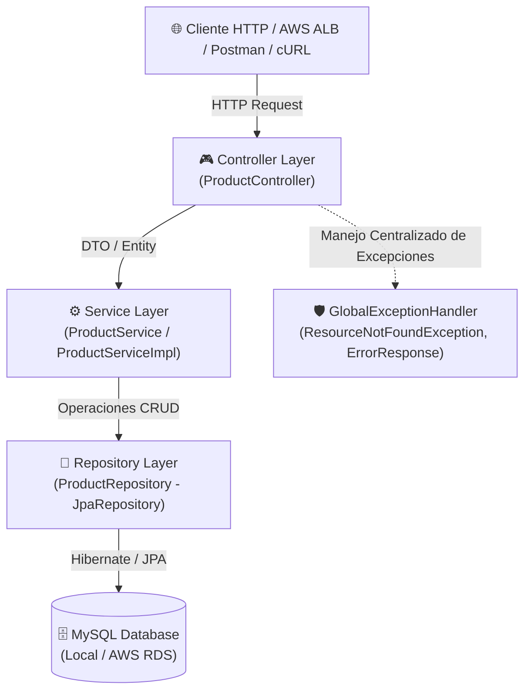
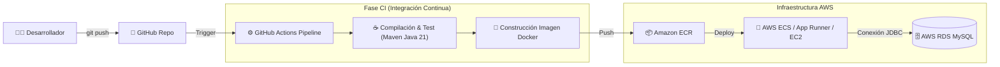

# 📦 Catalog Service API - Base Lab AWS & GitHub Actions

Microservicio REST desarrollado en **Java** con **Spring Boot** para la gestión de un catálogo de productos. Este repositorio sirve como proyecto base para laboratorios de integración continua y despliegue continuo (**CI/CD**) mediante **GitHub Actions** hacia infraestructura en **Amazon Web Services (AWS)**.

---

## 🚀 1. Tecnologías Utilizadas

| Categoría | Tecnología / Herramienta | Versión / Detalle |
| :--- | :--- | :--- |
| **Lenguaje** | [Java](https://www.oracle.com/java/) | 21 (LTS) |
| **Framework Base** | [Spring Boot](https://spring.io/projects/spring-boot) | 4.1.2 |
| **Capa Web** | Spring MVC (`spring-boot-starter-webmvc`) | Creación de endpoints y controladores REST |
| **Persistencia / ORM** | Spring Data JPA / Hibernate | Mapeo objeto-relacional y consultas CRUD |
| **Base de Datos** | [MySQL](https://www.mysql.com/) | 8.x (Driver: `mysql-connector-j`) |
| **Pool de Conexiones** | HikariCP | Configurado con optimizaciones en perfil `prod` |
| **Manejo de Errores** | `@RestControllerAdvice` | Respuestas estandarizadas de excepciones |
| **Monitoreo / Salud** | Spring Boot Actuator | Probes de Liveness/Readiness (`/actuator/health`) para balanceadores AWS |
| **Productividad** | Lombok | Reducción de código repetitivo (Boilerplate) |
| **Gestor de Construcción**| Apache Maven | Incluye Maven Wrapper (`mvnw` / `mvnw.cmd`) |
| **Destino de Despliegue** | AWS (EC2 / ECS / App Runner / Elastic Beanstalk) | Integración con RDS MySQL y GitHub Actions |

---

## 🏛️ 2. Arquitectura de la Aplicación

La aplicación está diseñada bajo el patrón de **Arquitectura en Capas (Layered Architecture)**, asegurando la separación de responsabilidades y modularidad.

### 2.1 Diagrama de Capas del Software



### 2.2 Descripción de Capas

1. **Capa de Controladores (`com.icodeap.catalog.controller`)**:
   - `ProductController`: Expone los endpoints REST bajo la ruta `/api/v1/products`, mapea las peticiones HTTP, delega la lógica al servicio correspondiente y devuelve las respuestas con sus códigos HTTP estándar.
2. **Capa de Negocio / Servicios (`com.icodeap.catalog.service`)**:
   - `ProductService` & `ProductServiceImpl`: Gestionan las reglas de negocio, validaciones y la orquestación de operaciones de catálogo.
3. **Capa de Persistencia (`com.icodeap.catalog.repository`)**:
   - `ProductRepository`: Interfaz que extiende de `JpaRepository<Product, Long>`, permitiendo interactuar con la base de datos sin escribir SQL directo.
4. **Capa de Dominio / Entidades (`com.icodeap.catalog.entity`)**:
   - `Product`: Representa la tabla `products` en la base de datos con los atributos: `id`, `name`, `description`, `category`, `stock` y `active`.
5. **Capa de Excepciones (`com.icodeap.catalog.exception`)**:
   - `GlobalExceptionHandler`: Interceptor global con `@RestControllerAdvice` para capturar errores como `ResourceNotFoundException` o excepciones generales, respondiendo con una estructura uniforme (`ErrorResponse`).

### 2.3 Flujo de Despliegue CI/CD (GitHub Actions + AWS)



---

## 📡 3. Endpoints Expuestos

La aplicación expone una API REST para la gestión de productos y endpoints de observabilidad para balanceadores de carga:

| Método | Endpoint | Descripción | Códigos HTTP |
| :--- | :--- | :--- | :--- |
| **POST** | `/api/v1/products` | Crea un nuevo producto en la base de datos | `201 Created`, `500 Internal Error` |
| **GET** | `/api/v1/products` | Obtiene la lista completa de productos | `200 OK`, `500 Internal Error` |
| **GET** | `/api/v1/products/{id}` | Obtiene los detalles de un producto por ID | `200 OK`, `404 Not Found` |
| **PUT** | `/api/v1/products/{id}` | Actualiza un producto existente | `200 OK`, `404 Not Found` |
| **DELETE** | `/api/v1/products/{id}` | Elimina un producto por ID | `204 No Content`, `404 Not Found` |
| **GET** | `/actuator/health` | Health Check y Probes de salud (AWS ALB / ECS) | `200 OK` |

### Modelo de Datos del Producto (`Product`)

```json
{
  "name": "Teclado Mecánico RGB",
  "description": "Teclado mecánico con switches red",
  "category": "Periféricos",
  "stock": 50,
  "active": true
}
```

---

## 💻 4. Ejemplos de Pruebas con cURL

Asegúrate de ajustar la variable de host según el entorno:
- Local: `http://localhost:8080`
- AWS (ALB / Instancia): `http://<TU_IP_O_DNS_AWS>:8080`

### 4.1 Health Check (Spring Boot Actuator)
Verifica el estado del servicio (ideal para configurar el Target Group del ALB de AWS):
```bash
curl -X GET http://localhost:8080/actuator/health
```
*Respuesta esperada:*
```json
{"status":"UP"}
```

---
### 4.2 Crear un Producto (`POST /api/v1/products`)
```bash
curl -X POST http://localhost:8080/api/v1/products \
  -H "Content-Type: application/json" \
  -d '{
    "name": "Laptop Gamer Pro",
    "description": "Portátil de alta gama con procesador Core i7 y 32GB RAM",
    "category": "Computadoras",
    "stock": 15,
    "active": true
  }'
```
*Respuesta esperada (HTTP 201 Created):*
```json
{
  "id": 1,
  "name": "Laptop Gamer Pro",
  "description": "Portátil de alta gama con procesador Core i7 y 32GB RAM",
  "category": "Computadoras",
  "stock": 15,
  "active": true
}
```

---
### 4.3 Listar Todos los Productos (`GET /api/v1/products`)
```bash
curl -X GET http://localhost:8080/api/v1/products
```
*Respuesta esperada (HTTP 200 OK):*
```json
[
  {
    "id": 1,
    "name": "Laptop Gamer Pro",
    "description": "Portátil de alta gama con procesador Core i7 y 32GB RAM",
    "category": "Computadoras",
    "stock": 15,
    "active": true
  }
]
```

---

### 4.4 Obtener Producto por ID (`GET /api/v1/products/{id}`)
```bash
curl -X GET http://localhost:8080/api/v1/products/1
```

Si el producto no existe:
```bash
curl -X GET http://localhost:8080/api/v1/products/999
```
*Respuesta esperada (HTTP 404 Not Found):*
```json
{
  "status": 404,
  "message": "Producto no encontrado con el ID: 999",
  "timestamp": "2026-10-24T10:00:00.000"
}
```

---

### 4.5 Actualizar un Producto (`PUT /api/v1/products/{id}`)
```bash
curl -X PUT http://localhost:8080/api/v1/products/1 \
  -H "Content-Type: application/json" \
  -d '{
    "name": "Laptop Gamer Pro Ultra",
    "description": "Portátil actualizada a 64GB RAM y pantalla OLED",
    "category": "Computadoras",
    "stock": 10,
    "active": true
  }'
```

---

### 4.6 Eliminar un Producto (`DELETE /api/v1/products/{id}`)
```bash
curl -X DELETE http://localhost:8080/api/v1/products/1
```
*Respuesta esperada (HTTP 204 No Content).*

---

## 🛠️ 5. Instrucciones para Levantado Local

### 5.1 Prerrequisitos
- **Java Development Kit (JDK)**: Versión 21 instalada (`java -version`).
- **Base de Datos MySQL**: Instancia local o contenedor Docker en el puerto `3306`.
- **Git** instalado.

---

### 5.2 Levantar la Base de Datos con Docker (Recomendado)
Para disponer rápidamente de una base de datos MySQL 8 local:

```bash
docker run -d \
  --name catalog-mysql \
  -p 3306:3306 \
  -e MYSQL_ROOT_PASSWORD=root \
  -e MYSQL_DATABASE=catalog_db \
  mysql:8.0
```

---

### 5.3 Compilar y Empaquetar el Proyecto

En **Windows (PowerShell / CMD)**:
```cmd
.\mvnw.cmd clean package -DskipTests
```

En **Linux / macOS**:
```bash
./mvnw clean package -DskipTests
```

Esto generará el archivo `.jar` ejecutable dentro de la carpeta `target/`:
`target/catalog-0.0.1-SNAPSHOT.jar`

---

### 5.4 Ejecución de la Aplicación

#### Opción A: Ejecutar mediante Maven Wrapper (Entorno de Desarrollo)
Con perfil `dev` activado (muestra logs SQL detallados):

*En Windows:*
```cmd
.\mvnw.cmd spring-boot:run -Dspring-boot.run.profiles=dev
```

*En Linux / macOS:*
```bash
./mvnw spring-boot:run -Dspring-boot.run.profiles=dev
```

#### Opción B: Ejecutar mediante archivo JAR empaquetado (Recomendado para Producción / Docker / AWS)
```bash
java -jar target/catalog-0.0.1-SNAPSHOT.jar --spring.profiles.active=prod
```

#### Opción C: Ejecutar pasando variables de entorno personalizadas (e.g., apuntando a AWS RDS)
```bash
export SPRING_DATASOURCE_URL="jdbc:mysql://mi-rds-cluster.us-east-1.rds.amazonaws.com:3306/catalog_db"
export SPRING_DATASOURCE_USERNAME="admin"
export SPRING_DATASOURCE_PASSWORD="MiPasswordSegura"
export PORT=8080

java -jar target/catalog-0.0.1-SNAPSHOT.jar
